# AWS Multi-Server Configuration Management with Ansible

An automated infrastructure configuration project showing how to set up an **Ansible Controller** in AWS that communicates **passwordlessly via SSH** to configure multiple target servers across both **public** and **private** subnets.

---

## 📌 Architecture Overview

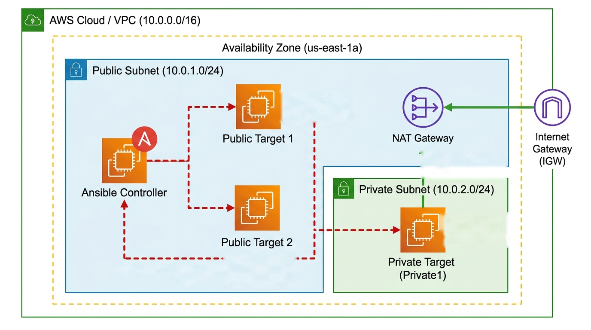

### Key Highlights
- **Agentless:** Ansible does not need any agent software installed on the target nodes—just standard OpenSSH and Python.
- **Passwordless SSH Setup:** An ED25519 keypair generated on the Ansible Controller allows seamless, non-interactive execution across all nodes.
- **Public & Private Multi-Tier:** Demonstrates that Ansible can orchestrate both internet-facing servers and isolated private servers.
- **NAT Gateway for Private Subnet:** A NAT Gateway in the public subnet allows the private server to download required packages (`postgresql`, `nginx`) from the internet without having a public IP or inbound internet exposure.
- **Free Tier Budgeted:** Uses 4 `t3.micro` instances (2 vCPUs each = 8 vCPUs total), staying within the AWS free tier limit.

---

## 📂 Project Structure

```
.
├── images/
│   ├── 01-vpc.png
│   ├── 02-subnets.png
│   ├── 03-instances.png
│   ├── 04-ssh-permission-denied.png
│   ├── 05-ssh-keygen.png
│   ├── 06-authorized-keys.png
│   ├── 07-playbook-run-part1.png
│   ├── 08-playbook-run-part2.png
│   ├── 09-adhoc-verification.png
│   └── 10-adhoc-python-install.png
├── aws-cli-commands.txt       # Script used to launch all EC2 instances via CLI
├── aws-resources-info.txt     # Subnet and Security Group IDs reference
├── inventory.ini              # Grouped server hosts and connection variables
├── first-playbook.yml         # Playbook automating software installation
└── README.md
```

---

## 🛠️ Step 1: AWS Infrastructure Setup

All resources were provisioned using AWS CLI commands instead of clicking through the console every time.

### 1.1 Custom VPC
Created a custom VPC named `ansible-lab-vpc` (`vpc-0b20b1a86c4801836`) with a CIDR block of `10.0.0.0/16` to isolate all lab resources.

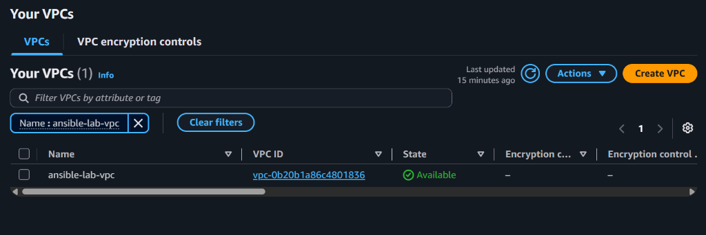

---

### 1.2 Public and Private Subnets
Configured two distinct subnets:
- **`ansible-public-subnet`** (`10.0.1.0/24`): Hosts the Ansible Controller and public web servers. Attached to an Internet Gateway and NAT Gateway.
- **`ansible-private-subnet`** (`10.0.2.0/24`): Hosts the private database server with no public IP address, routing outbound traffic through the NAT Gateway.

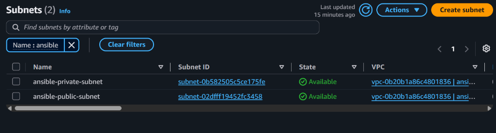

---

### 1.3 EC2 Instances using AWS CLI
Launched 4 `t3.micro` Ubuntu 24.04 LTS instances:
1. `ansible-controller` (`10.0.1.233`) — Control node running Ansible.
2. `ansible-public` 1 (`10.0.1.51`) — Target public server.
3. `ansible-public` 2 (`10.0.1.164`) — Target public server.
4. `ansible-private` (`10.0.2.12`) — Target private database server (no public IP).

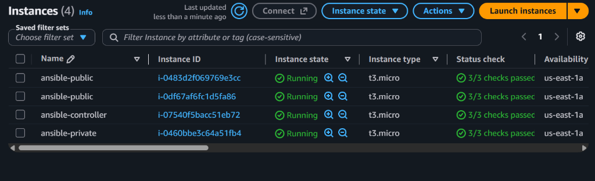

---

## 🔑 Step 2: Passwordless SSH Setup

For Ansible to manage nodes without manual intervention, the controller node must communicate with all target servers without being prompted for a password or key each time.

### 2.1 The Issue: Permission Denied
When attempting to SSH from the controller (`10.0.1.233`) into the target servers (`10.0.1.51`, `10.0.1.164`, `10.0.2.12`), the connection was rejected with `Permission denied (publickey)` because the controller's key was not yet trusted by the targets.

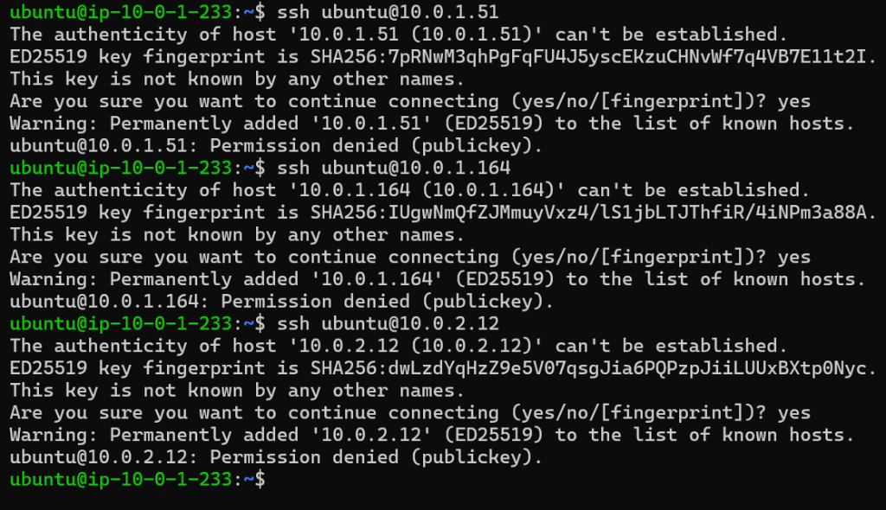

---

### 2.2 Generating ED25519 Key on Controller
On the `ansible-controller` server:
1. Checked Ansible version (`ansible [core 2.16.3]`, Python 3.12.3).
2. Generated a dedicated ED25519 SSH keypair with no passphrase using:
   ```bash
   ssh-keygen -t ed25519
   ```

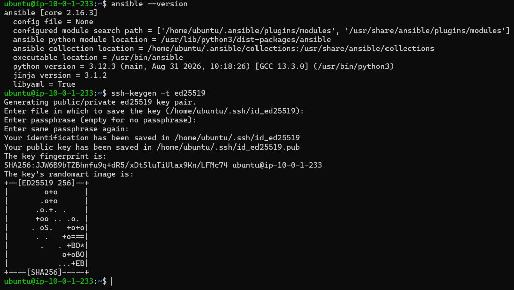

---

### 2.3 Adding Public Key to All Target Servers
Copied the public key from the controller (`~/.ssh/id_ed25519.pub`) and appended it into `~/.ssh/authorized_keys` on each target server (`public1`, `public2`, and `private1`).

Below you can see the controller's ED25519 key successfully added to `~/.ssh/authorized_keys` alongside the original AWS keypair:

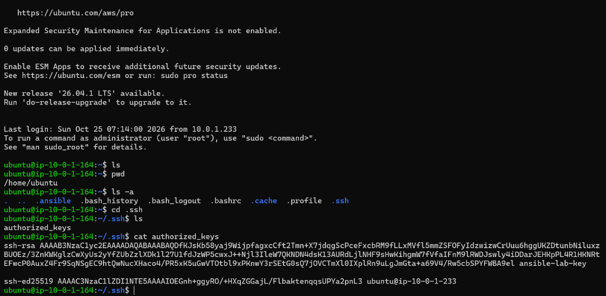

After this step, the controller can connect to all target nodes passwordlessly!

---

## 🚀 Step 3: Running the Ansible Playbook

On the controller node, created the project directory with:
- **`inventory.ini`**: Configures `public` and `private` host groups:
  ```ini
  [public]
  public1 ansible_host=10.0.1.51
  public2 ansible_host=10.0.1.164

  [private]
  private1 ansible_host=10.0.2.12

  [all:children]
  public
  private

  [all:vars]
  ansible_user=ubuntu
  ```
- **`first-playbook.yml`**: Automates:
  - **All servers**: Installs, enables, and starts **Nginx**.
  - **Public servers**: Installs **Git** and **Docker**, then starts and enables the Docker service.
  - **Private servers**: Installs, enables, and starts **PostgreSQL** (downloaded via NAT Gateway).

### 3.1 Executing the Playbook
Executed the playbook using:
```bash
ansible-playbook -i inventory.ini first-playbook.yml
```

The first phase gathers facts, installs Nginx across all servers, and starts the Nginx service:

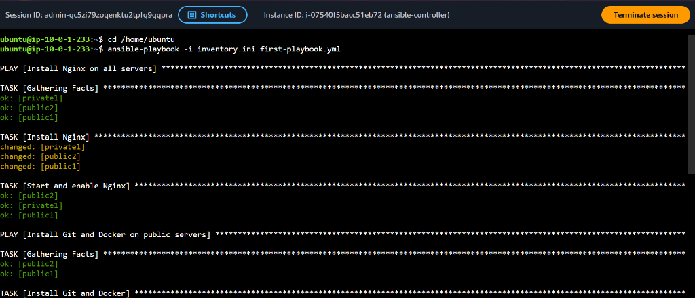

---

### 3.2 Playbook Completion & Summary
The playbook proceeds to install Git and Docker on the public nodes, and PostgreSQL on the private node. The play recap shows **100% success** with zero failures or unreachable hosts:

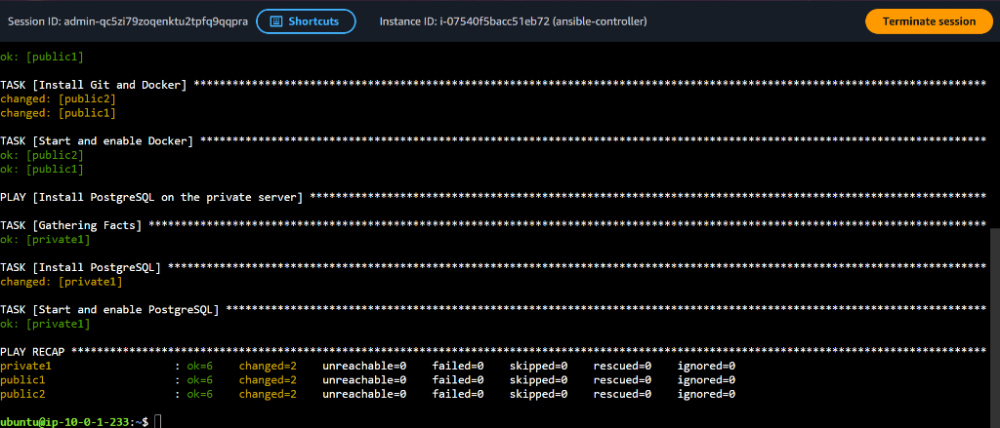

---

## ⚡ Step 4: Verification Using Ad-Hoc Commands

While **Playbooks** are used when there are many multi-step tasks, **Ad-Hoc Commands** are ideal for quick checks, one-off service restarts, or single package installs.

### 4.1 Verifying Installed Packages and Service Status
Used ad-hoc commands with the `command` and `shell` modules to verify all installations across the server groups:
- **Git version on public servers:** `ansible public -i inventory.ini -m command -a "git --version"` → `git version 2.43.0`
- **Nginx status on all servers:** `ansible all -i inventory.ini -m shell -a "systemctl is-active nginx"` → `active` on all 3 nodes
- **Docker version on public servers:** `ansible public -i inventory.ini -m command -a "docker --version"` → `Docker version 29.1.3`
- **PostgreSQL status on private server:** `ansible private -i inventory.ini -m shell -a "systemctl is-active postgresql"` → `active` on `private1`

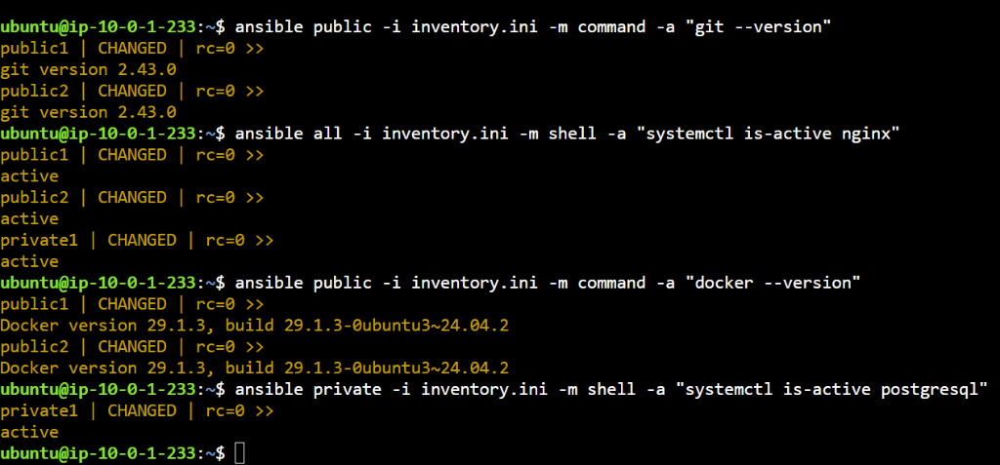

---

### 4.2 Installing Python via Ad-Hoc Command
To demonstrate a quick one-off installation without modifying the playbook, installed `python3` on `public1` using the `apt` module with privilege escalation (`-b`):
```bash
ansible public1 -i inventory.ini -b -m apt -a "name=python3 state=present update_cache=yes"
```
Then verified the version:
```bash
ansible public1 -i inventory.ini -m command -a "python3 --version"
```
Output confirmed `Python 3.12.3`.

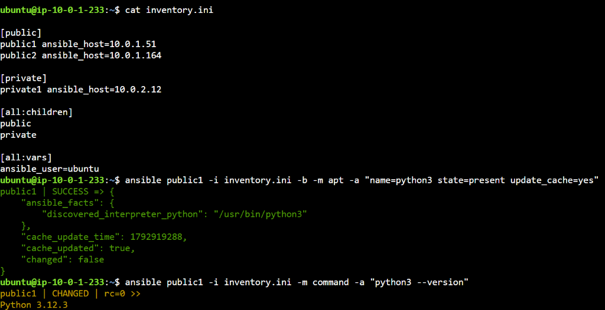

---

## 💡 Summary
1. **AWS CLI Provisioning:** Rapidly stood up multiple EC2 instances via CLI and rest of the infrastructure using the console.
2. **Passwordless Setup:** Generated ED25519 key on the controller and distributed the public key to all targets.
3. **NAT Gateway Routing:** Allowed isolated private servers to fetch software packages from the web safely.
4. **Ansible Automation:** Executed structured group deployments via playbooks and performed real-time inspection & single-task package management via ad-hoc commands.
